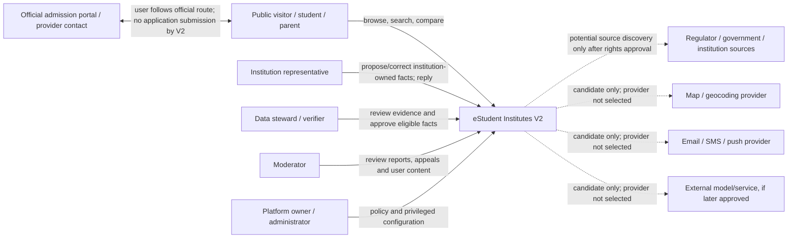

# M2-S01 — System Context and Capability Boundary

**Status:** Proposed logical context; external integrations are not approved.  
**System:** eStudent Institutes V2

## 1. Context view

Solid relationships represent logical user interactions with V2. Dashed relationships are possible future external-service/source boundaries only; they are not active integrations, approved permissions or selected vendors. The external admission route is followed by the user outside V2.

## 2. Logical capability boundary

Within V2:
- Public discovery and information presentation.
- Education provider, institution, campus and programme catalogue.
- Admissions, eligibility, fees, scholarships and recognition evidence.
- Source authorization, provenance, validation, conflict and publication governance.
- AI-assisted extraction/reconciliation proposal workflow with human approval.
- Accounts and user preferences for features requiring identity.
- Post-launch reviews, reports, moderation and appeals.
- Administration, visibility configuration and audit.

External to V2:
- Source owners and their websites/registers.
- Provider admission/application systems and official contact channels.
- Optional map/geocoding, messaging, AI/model, hosting and other third-party services.
- User devices, browsers and networks.

## 3. Trust boundaries

1. **Public visitor boundary:** anonymous requests may read only eligible public data; no private account or internal evidence leakage.
2. **Authenticated user boundary:** account identity permits user-specific actions but does not prove student attendance or institution affiliation.
3. **Institution representative boundary:** may propose facts about the represented provider and exercise approved response rights; cannot confer regulatory recognition or approve own submissions.
4. **Steward/verifier boundary:** can review evidence and approve only within assigned authority and policy.
5. **Moderator boundary:** review decisions are distinct from commercial or institution account privileges.
6. **Privileged administration boundary:** visibility and security configuration changes require restricted permission, re-authentication where appropriate and audit.
7. **External source/service boundary:** retrieved content is untrusted data; source access is blocked until rights and security authorization. External service data cannot become trusted solely because it came through an API.

## 4. Deeni Madaris public-visibility invariant

The Show Deeni Madaris setting is a platform policy input with default OFF. When OFF, all public discovery outputs must suppress the category consistently, including search, browse, map, recommendation, counts, sitemap, export and public API surfaces. Suppression must not delete or mutate underlying provider records or regulatory evidence. No sect/maslak discovery attribute is introduced.

## 5. Deferred context decisions

The context view deliberately does not decide:
- Monolith, modular monolith, services or deployment topology.
- Browser/server framework, backend language, database or search engine.
- Identity provider or account architecture.
- Map, geocoding, email, SMS, push, analytics or AI vendor.
- Any source connector or refresh schedule.

These are assigned to M2-S03/S04/S07/S08/S09 and remain subject to owner approval and rights/cost/security gates.
