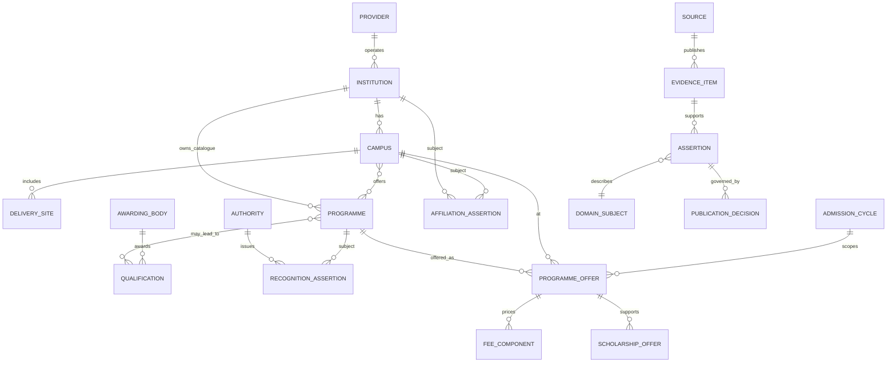

# M2-S02 — Core Domain and Conceptual Information Model

**Status:** Architecture documentation baseline; owner acceptance pending
**Depends on:** Accepted M2-S01
**Scope:** Conceptual domain semantics only. This is not a physical database schema, table design, API contract or migration plan.

## 1. Design intent and rules

The domain model must preserve distinctions that are often collapsed in education directories: an operating/legal provider is not necessarily the same thing as an institution identity; an institution may operate multiple campuses; programmes and qualifications are different concepts; recognition and affiliation are authority-specific claims; admissions and fees are session-scoped offers; and a source document is evidence for an assertion, not the assertion itself.

The model is evidence-centred, temporally explicit and capable of representing uncertainty. It must not manufacture completeness where source coverage is partial. A missing value is not zero, false, unrecognized or not applicable unless an authoritative source explicitly establishes that state.

## 2. Domain glossary

| Term | Meaning | Important distinction |
|---|---|---|
| Education Provider | Organization or accountable operator responsible for one or more education institutions/campuses | Legal/operator identity; not automatically a public-facing institution |
| Institution | Recognizable education entity presented to students under an identity/name | May be operated by a provider; may have multiple campuses |
| Campus | A named, geographically situated delivery site or branch | Has its own location, contact, operational status and offered programmes |
| Delivery Site | A physical or approved non-campus place where a programme is delivered | Do not assume every delivery site is a campus |
| Programme | A structured course of study/training offered by an institution or campus | Not the same as the award/qualification |
| Qualification | An award, credential or level resulting from successful study/assessment | May be issued/awarded by a body other than the teaching provider |
| Awarding Body | Entity legally/officially responsible for issuing a qualification | Separate from teaching provider and regulator |
| Regulator / Recognizing Authority | Competent body that registers, recognizes, licenses or regulates a defined scope | Authority and scope must be explicit |
| Affiliation | A time- and scope-bounded relationship between an institution/campus and an awarding body, university or board | Not interchangeable with recognition or accreditation |
| Recognition / Accreditation | Authority-issued status applying to a defined entity, programme, campus, qualification or period | Must retain authority, scope, status wording and effective dates |
| Admission Cycle | A named intake/session/window for a programme or campus | Eligibility, deadlines and fees may vary by cycle |
| Programme Offer | A programme's availability at a campus for a specific cycle | A general programme catalogue entry is not proof of a current offer |
| Fee Component | A named charge with amount, currency, frequency, applicability and effective period | Do not collapse one-time and recurring costs |
| Scholarship / Aid Offer | Financial support with eligibility, coverage, value, period and conditions | Advertised availability is not guaranteed award |
| Source | Publisher/owner of a dataset, register, document or page | Public accessibility does not imply reuse permission |
| Evidence Item | Captured, referenced or manually recorded material supporting one or more factual assertions | Evidence may be stale, partial, disputed or withdrawn |
| Assertion | A normalized, attributable claim about a domain subject and property | Retain source-native wording and provenance |
| Publication | A governed decision to expose an eligible assertion to a specified audience/surface | Publication is separate from discovery and extraction |
| Identity Candidate | A possible match between records/entities awaiting resolution | Similarity is not proof of identity |
| Provider Category | Broad provider classification used for governed scope and presentation | Deeni Madaris handling is controlled by V2-DEC-006 |
| Student Review | Authenticated user's opinion/experience about an eligible target | Opinion is not official evidence or proof of attendance |

## 3. Conceptual entities and relationships

The diagram is conceptual. Many relationships are many-to-many or time-bounded in practice; the diagram intentionally avoids prescribing physical keys, join tables or storage technology.

### Relationship rules
- One provider may operate multiple institutions; an institution may have more than one historical/current operator over time. Preserve effective dates and evidence for operator changes.
- An institution may have multiple campuses. A campus belongs to one institution identity at a time in the normal case; mergers, transfers and disputed branch ownership require explicit history rather than silent reassignment.
- Programmes may be catalogued at institution level but must be linked to a campus-specific offer before asserting campus availability.
- A programme can lead to multiple qualifications, and a qualification may be delivered through multiple programmes. Awarding body is independent of teaching provider.
- Recognition, licensing, accreditation and affiliation are separate typed relationships. Every status is scoped to its competent authority, subject, programme/campus where applicable, jurisdiction, effective period and source.
- A programme offer belongs to one admission cycle and one campus. A cycle may be open, closed, upcoming, paused or unknown; source wording and observation time are retained.
- Fee and scholarship facts attach to the relevant offer/cycle whenever known. Unscoped fee amounts must not be presented as current campus-specific totals.
- Reviews attach to a clearly identified eligible target and remain student opinion, never a substitute for regulator or provider evidence.

## 4. Identity, matching and deduplication

### Identity principles
1. Use stable internal identity independent of name, address, URL, source row number or mutable status.
2. Retain source-native identifiers with their issuing source and namespace; never assume IDs are globally unique.
3. Separate an entity's canonical identity from names, aliases, transliterations, historical names, brands and local spellings.
4. A shared name, phone number, address, domain or coordinate is a matching signal, not conclusive identity.
5. Preserve raw source records and the decision trail for merges, splits, redirects and rejected matches.
6. Never merge a provider, institution, campus, regulator, awarding body or qualification solely because names are similar.
7. Human review is required for ambiguous/high-impact identity merges; confidence scores can prioritize review but cannot authorize publication.

### Candidate match dimensions
- Source-scoped identifier and issuing authority.
- Legal/registered name and alternate/trading name.
- Institution type and jurisdiction.
- Address, coordinates and locality, with source and precision.
- Official domain and verified contact route.
- Parent/operator relationship and temporal overlap.
- Campus/branch designation and programme/affiliation context.

### Match outcomes
`unreviewed_candidate`, `probable_match_for_review`, `confirmed_same_entity`, `distinct_entities`, `superseded_identity`, `split_required`, `disputed`. These are conceptual workflow labels, not a database enum.

## 5. Temporal and lifecycle semantics

Keep at least four different times distinct:
- **Valid time:** when the fact is true in the real world or according to the authority.
- **Observed time:** when V2 or an authorized reviewer observed the source.
- **Recorded time:** when the assertion/decision entered the governed system.
- **Publication time:** when a decision made the assertion visible to a defined audience.

A fact may have an effective start/end, an observation timestamp, a record timestamp and a publication interval. Do not overwrite historical assertions when a source changes. Correct errors by superseding or retracting with a reason and retained lineage.

### Conceptual lifecycles

| Object | Conceptual lifecycle |
|---|---|
| Provider/institution/campus identity | Candidate → verified → active / inactive / merged / split / disputed |
| Source authorization | proposed → rights/security review → approved for a defined purpose/method OR denied / expired / revoked |
| Evidence item | discovered → authorized-to-access → captured/referenced → validated / rejected / stale / withdrawn |
| Assertion | extracted/proposed → normalized → corroborated / disputed → reviewed → approved / rejected → superseded / retracted |
| Programme offer | proposed → verified → upcoming → open → closed / paused / cancelled / unknown |
| Recognition/affiliation | reported → authority-evidenced → effective → expired / suspended / withdrawn / disputed |
| Publication decision | pending → approved for surface/audience → published → corrected / withdrawn / expired |
| Review | submitted → moderation pending → published / rejected → reported / under appeal → removed / restored |

A transition requires an attributable actor or governed process, timestamp, reason where material and evidence/policy basis. State labels must not erase source-native statuses.

## 6. Classification and Deeni Madaris invariant

Provider categories are descriptive, not sect/maslak taxonomies. The Show Deeni Madaris setting is platform-wide, owner-controlled and defaults OFF. While OFF, Deeni Madaris must be excluded from every public output: search, browse, maps, recommendations, aggregate counts, sitemap, export and public APIs. The underlying provider identities, evidence and provenance remain retained and governed. No sect/maslak discovery filter, ranking or profiling attribute is introduced. Public suppression is a publication/discovery policy, not data deletion.

## 7. Uncertainty, conflict and completeness

Represent at least: unknown, not supplied, not applicable, source says none, disputed, stale, partial, pending verification and withdrawn. Do not coerce these states into null/zero/false without preserving meaning.

Conflicting assertions coexist with source authority, valid period, observed time and reviewer disposition. A newer source is not automatically more authoritative; authority depends on the fact and jurisdiction. Coverage statements must name scope, period, source coverage and limitations; never imply a complete national census.

## 8. Requirements and downstream trace

- AR-003: provider/institution/campus/programme identities are separate and searchable at appropriate scopes.
- AR-005–AR-007, AR-015, AR-019: uncertainty, provenance, temporal history and conflicts remain explicit.
- AR-006: programme/admission facts are campus/programme/cycle scoped.
- AR-013–AR-014: source authorization precedes retrieval; AI output remains a proposal.
- AR-016–AR-018: Deeni Madaris default-OFF and no sect/maslak discovery.
- AR-023: identity resolution, review and publication decisions are attributable and auditable.

## 9. Deliberately unresolved for later steps

Physical keys, normalization, database technology, indexing strategy, exact status vocabularies per regulator, geospatial precision, API payloads, retention periods, source refresh cadence, identity proofing, and migration/backfill are not decided here. M2-S04/S05/S06/S07/S08/S09 and owner decisions govern these topics.

## 10. S02 exit checklist

- Glossary separates provider, institution, campus, programme, qualification, authority, affiliation, offer, cycle, evidence and assertion.
- Relationship and cardinality edge cases are explicit.
- Identity matching does not equate similarity with proof.
- Valid/observed/recorded/publication time are distinct.
- Lifecycle, conflict and uncertainty semantics preserve history.
- Deeni Madaris default-OFF invariant is explicit.
- No physical schema, API, stack or implementation choice is smuggled into the conceptual model.
