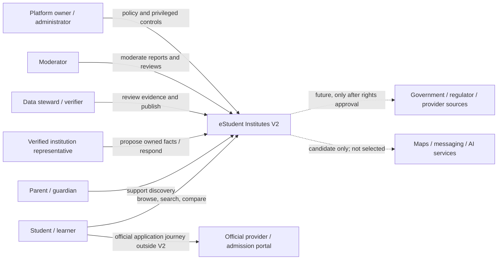
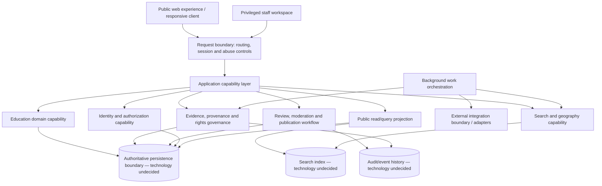

# M2-S03 — Overall Application and Integration Architecture

**Status:** Logical architecture baseline; owner acceptance pending
**Depends on:** Accepted M2-S01 and M2-S02 conceptual model
**Scope:** Technology-neutral application, integration and runtime design. Containers below are logical responsibilities, not a commitment to separately deployed services.

## 1. Architecture drivers

The architecture must support public, anonymous discovery; scoped education-domain identities; evidence-backed facts and explicit uncertainty; rights-gated source handling; human review; authenticated post-launch reviews; privacy and safeguarding; mobile/low-bandwidth access; and platform-wide Deeni Madaris default-OFF suppression. It must remain viable while national data coverage, source rights, traffic, operating budget and hosting constraints are not yet quantified.

## 2. C4-style system context

The dashed connections are not active integrations, permissions or vendor selections. Students follow official admission routes themselves; V2 does not submit applications.

## 3. Logical container view

This is a logical responsibility map. It does not prescribe a monolith, modular monolith, microservices, process count, database product, search engine, event broker or hosting provider. M2-S04 evaluates these choices. A single deployable may initially host multiple capabilities if later evaluation supports that choice; logical separation must still be testable and enforceable.

## 4. Component boundaries and contracts

| Logical component | Owns / does | Must not do |
|---|---|---|
| Public experience | Browse/search/profile/compare, accessible responsive presentation | Read private evidence, bypass visibility policy or require location permission |
| Staff workspace | Stewardship, verification, moderation and configuration interfaces | Grant itself authority or bypass separation of duties |
| Request boundary | Route requests, enforce safe defaults, rate/abuse controls, session boundary | Become the source of business authorization truth |
| Identity and authorization | Authentication, sessions, role/action decisions and account lifecycle | Treat login as proof of attendance, affiliation or age |
| Education domain | Provider/institution/campus/programme/qualification/cycle/offer relationships | Infer identity from names or overwrite historical assertions |
| Evidence and rights governance | Source registry, rights gates, evidence lineage, assertions, conflict and temporal semantics | Retrieve a source before source-specific approval |
| Review and publication workflow | Human review, decision records, publication, correction and rollback | Publish AI output or unreviewed high-impact facts automatically |
| Discovery/query | Public search, browse, filters, map projections and comparison queries | Expose suppressed/private/unapproved facts or invent missing values |
| Integration adapters | Encapsulate explicitly approved external contracts and credentials | Treat public accessibility as permission or trust remote payloads |
| Background orchestration | Scheduled/manual authorized jobs, retries, idempotency and dead-letter handling | Run unapproved crawlers, agents or source refreshes |
| Audit/operations | Append-only attributable records, metrics, logs and recovery signals | Store secrets or unnecessary personal data in logs |

### Contract principles
- Components exchange typed domain concepts and explicit outcomes, not loosely interpreted display strings.
- Every write-side command identifies actor/process, authorization context, correlation identifier and reason where material.
- Read projections are derived from approved publication decisions; they are not independent authority.
- Integration adapters validate schema, origin, scope, timestamps and signatures where applicable; external content is untrusted.
- Async work is idempotent, bounded, observable, retry-safe and stoppable. A retry must not duplicate publication or erase provenance.
- Cross-component events are versioned contracts; delivery is at-least-once tolerant unless later technology analysis establishes a stronger guarantee.
- Public query contracts enforce audience, publication state, rights, privacy and Deeni Madaris visibility before returning data.

## 5. Integration architecture and approval gates

| Boundary | Purpose | Current status | Gate before activation |
|---|---|---|---|
| Government/regulator/provider sources | Evidence for education facts | RESEARCH ONLY | Source-specific rights, security, privacy, method and retention approval |
| Maps/geocoding | Map display or locality resolution | Candidate only | Provider selection, cost, privacy, terms and degraded-mode assessment |
| Email/SMS/push | Account notices and opt-in reminders | Candidate only | Vendor, consent, deliverability, cost and data-processing approval |
| AI/model services | Candidate extraction/classification assistance | Candidate only | M2-S07 threat/cost design, source authorization, privacy and owner approval |
| Identity federation | Optional sign-in convenience | Not selected | M2-S08 security, privacy and vendor evaluation |
| Analytics/advertising | Product measurement or monetization | Not selected | Purpose limitation, consent, privacy and owner approval |

No connector is configured, no external service is called and no source is accessed by this architecture document.

## 6. Runtime and interaction scenarios

### A. Anonymous public discovery
1. Browser requests a public search/profile route.
2. Request boundary applies abuse controls and forwards a read query.
3. Discovery resolves only published, audience-eligible projections.
4. Deeni Madaris policy is applied consistently at the public query boundary and any derived index/projection.
5. Response includes explicit missing/stale/partial states and source dates where applicable.
6. Optional map/geolocation service failure does not prevent manual locality search or list-based discovery.

### B. Evidence proposal and publication
1. A source candidate is checked against a source-specific authorization record before any retrieval.
2. Authorized evidence is captured/referenced with source identity, method, observation time and integrity metadata.
3. Extraction/normalization creates proposed assertions, never public facts.
4. Validation checks scope, temporal semantics, authority, duplicates, conflicts and provenance.
5. A qualified human reviewer approves, rejects or requests clarification within delegated scope.
6. Publication creates an audience/surface-scoped decision and updates read projections/indexes.
7. Correction/withdrawal supersedes the prior decision while retaining audit and evidence lineage.

### C. Institution-submitted correction
1. Representative identity and provider relationship are verified separately.
2. Submission is stored as a claim with submitter attribution; it does not overwrite official-source evidence.
3. Steward checks conflicts, evidence and delegated authority.
4. Approved assertions are published with source classification; rejection/appeal retains reasons.

### D. Post-launch review
1. Authenticated user submits a review against an eligible institution/campus/programme target.
2. Rate/abuse and moderation checks apply; login does not prove attendance.
3. Review remains pending until moderation policy permits publication.
4. Reports, appeals, removal/restoration and audit are separate workflow states.
5. Reviews are clearly distinguished from verified institutional facts and sponsored content.

### E. Privileged configuration
1. Administrator authenticates with strong controls.
2. Authorization checks a specific permission for the requested setting/action.
3. Sensitive changes, including Show Deeni Madaris, require explicit confirmation, audit reason and attributable record.
4. Cache, index and every public projection are invalidated/rebuilt consistently; partial propagation must fail closed for suppressed categories.
5. No public endpoint may override the policy state.

## 7. Failure, degradation and recovery scenarios

| Failure | Required behaviour | Recovery / evidence |
|---|---|---|
| Search index unavailable | Fall back to bounded browse/query path where feasible; never serve stale private data | Alert, reconcile index from approved publication state |
| Map/geocoding unavailable | Manual locality and text/list discovery remain usable | Retry optional service; no location permission escalation |
| External source unavailable or revoked | Stop affected retrieval; preserve last known evidence with age/authorization status; suppress if policy requires | Reauthorization and source-specific resumption decision |
| AI/model unavailable or malformed | Queue/retry safely or route to manual review; no fabricated fact | Dead-letter/quarantine with error and provenance |
| Conflicting evidence | Keep assertions disputed; do not auto-select newest or overwrite | Steward adjudication with recorded basis |
| Async duplicate/retry | Idempotency prevents duplicate assertion/publication effects | Correlation IDs and replay-safe processing |
| Partial visibility-policy propagation | Fail closed: suppressed records remain absent from every public surface | Rebuild and verify search, cache, maps, counts, exports and APIs |
| Primary persistence degraded | Protect writes and preserve integrity; communicate service degradation | Restore from verified backup and reconcile audit/event history |
| Privileged account compromise suspected | Restrict/revoke privileged sessions and pause high-impact actions | Incident process and attributable recovery review |

## 8. Cross-cutting security and quality controls

- Default deny for privileged actions and source access.
- Separate authentication from authorization and institutional relationship verification.
- Keep secrets out of logs, prompts, source documents and client bundles.
- Treat source content, uploads and model output as untrusted input; defend against prompt injection and malicious files.
- Apply data minimization, purpose limitation, retention controls and access segregation.
- Protect audit integrity and record sensitive administrative/publication changes.
- Enforce public visibility policy in authoritative query paths and derived read models.
- Use accessible, responsive, Unicode-safe and RTL-capable presentation.
- Defer numeric SLOs, capacity, RPO/RTO and hosting cost until M2-S09 evidence.

## 9. Explicitly undecided

No choice is made among monolith/modular monolith/services, frontend/backend frameworks, languages, databases, queues, search engines, map providers, identity services, cloud/hosting vendors, observability products, AI/model vendors or deployment topology. Those are M2-S04/S07/S09 evaluation subjects and require owner approval where consequential.

## 10. Requirements trace

AR-001–AR-005, AR-021–AR-024 map to public experience, request boundary and discovery; AR-006–AR-007 and AR-013–AR-015 map to domain/evidence/workflow; AR-008–AR-010 map to comparison/discovery; AR-011–AR-012 map to identity/review/privacy; AR-016–AR-018 map to the cross-surface visibility policy; AR-023–AR-025 map to audit, operations and recovery. S08/S09 will deepen controls and measurable targets.

## 11. S03 exit checklist

- System context and external trust boundaries are explicit.
- Logical containers and component responsibilities are separated without implying deployment topology.
- Integration contracts and approval gates are deny-by-default.
- Core runtime scenarios cover public discovery, evidence publication, corrections, reviews and privileged configuration.
- Failure/degraded-mode behaviours are specified.
- S02 domain semantics and AR requirements are traceable.
- No technology/vendor/production decision is implied.
