# M2-S06 — Search, Discovery and Geography Architecture

**Status:** Logical discovery design; owner acceptance pending  
**Depends on:** Accepted S02/S03; coordinated with S04/S05  
**Scope:** Search, browse, comparison, indexing, map and location architecture. No live geocoding, external provider activation, map procurement or data ingestion is authorized.

## 1. Goals and discovery principles

Discovery must help students and families find and compare institutions, campuses, programmes and cycle-specific offers without overstating data coverage or certainty. Public results are derived from approved publication decisions, not directly from source/evidence stores.

Principles:
- Anonymous browse and text search work without login or location permission.
- Manual locality selection is always available; precise device location is optional and user initiated.
- Search must tolerate spelling variation and multilingual names without silently merging distinct entities.
- Every result preserves the distinction between institution and campus, and programme availability and general catalogue.
- Missing, unknown, stale, disputed and partial facts remain visible as different states.
- Sponsored placement, if ever introduced, is visibly labelled and separate from organic relevance.
- All public search, browse, map, count, recommendation, sitemap, export and API paths apply the same publication and visibility rules.

## 2. Discovery capability map

| Capability | User need | Logical behaviour |
|---|---|---|
| Global search | Find by institution, campus, programme, qualification or alias | Typed search across published eligible documents |
| Browse by geography | Explore country/province/district/city/locality | Hierarchical filters and map/list modes |
| Browse by education attributes | Compare provider type, level, programme, awarding body or cycle | Controlled facets with clear definitions |
| Institution/campus profile | Inspect identity, location, programmes, contacts and evidence dates | Distinct entity/campus views with source and freshness metadata |
| Programme/admission discovery | Find currently offered programmes and cycle-specific deadlines | Filter on offer/cycle state and effective dates; unknown is not open |
| Comparison | Compare comparable attributes | Side-by-side normalized values, missingness and dates |
| Map discovery | See published campus points and choose an area | Map/list synchronized; list remains usable without tiles |
| Recommendations | Explain relevant options without hidden sponsored ranking | Transparent criteria and exclusions; no sensitive profiling |
| Official next step | Continue application through provider's official route | External link with destination context; no V2 application submission |

## 3. Search query pipeline

```mermaid
flowchart LR
  Input[Query and filters] --> Normalize[Unicode and locale normalization]
  Normalize --> Expand[Approved aliases, spelling variants and transliteration]
  Expand --> Parse[Entity type, programme, cycle and locality intent]
  Parse --> Retrieve[Retrieve from eligible public index]
  Retrieve --> Policy[Publication, rights, privacy and category policy]
  Policy --> Rank[Relevance and completeness-aware ranking]
  Rank --> Explain[Reason, freshness and uncertainty labels]
  Explain --> Results[Results / facets / map-list view]
```

Normalization must preserve original input and use conservative equivalence rules. Do not strip diacritics or normalize Urdu/Arabic code points in a way that destroys meaningful distinctions. Transliteration and spelling expansions are retrieval aids, not identity proof. Query logs must be minimized, access controlled and retained only under an approved purpose/retention schedule.

### Search fields and retrieval behaviour
- Exact official/current name and verified aliases.
- Local-language name, alternate script, transliteration and common spelling variants when verified or safely generated.
- Provider/institution/campus type and administrative geography.
- Programme, qualification, awarding body and admission cycle.
- Explicitly published contact/official URL fields where rights and privacy permit.
- Exact-match boosts; then verified alias and phrase match; then typo-tolerant/fuzzy retrieval with conservative thresholds.
- Facets are generated only from public eligible documents and counts use the same policy-filtered population.
- Ranking must not treat missing facts as negative values or reward unverified claims.

No final search engine is selected. S04 compares database-native search, Meilisearch and OpenSearch. Benchmark on an authorized/synthetic bilingual corpus before adopting a separate index.

## 4. Index and projection governance

The authoritative assertion/publication history remains the source of truth. Search and map indexes are disposable, rebuildable read projections.

Projection document conceptually includes:
- stable entity/campus identifier and type;
- published names and permitted aliases;
- programme/qualification and cycle facets;
- public locality and public coordinate (if authorized);
- publication decision/version and freshness state;
- audience/surface eligibility and category visibility state;
- source attribution/last verified dates as permitted.

Projection update requirements:
1. Only approved assertions can enter public projections.
2. Projection events are versioned, idempotent and replayable.
3. Rebuild uses the authoritative publication state, not source data or model output.
4. Revocation/correction triggers cache and index invalidation.
5. A projection lag or failure must not leak newly suppressed/private data; high-impact policy changes fail closed.
6. Counts, facets, sitemap and API use consistent eligibility rules.
7. Search index is not a system of record; loss of index must be recoverable by rebuild.

## 5. Ranking and result quality

Ranking dimensions may include query match, entity type, locality relevance, verified programme availability, freshness and completeness. Weights are not set until representative query evaluation. Do not use popularity, paid placement, review score or click-through as hidden relevance proxies.

Display:
- why a result matched (name, programme, location, qualification);
- whether the item is an institution or campus;
- last verified/observed date and source class where publishable;
- stale/partial/unknown states;
- whether a programme is a current cycle offer or a general catalogue item;
- official external next-step link and clear off-platform handoff.

Comparison should show "not supplied", "not verified", "not applicable", "disputed" and "stale" distinctly. Avoid a composite score unless its methodology, coverage bias and sponsorship exclusions are explicit and owner-approved.

## 6. Geography and coordinate quality

### Conceptual location quality
Each location assertion should distinguish:
- point/area/address/locality type;
- source and authority;
- capture/observation time;
- coordinate reference system and precision/accuracy where known;
- geocoding method/provider and confidence;
- public display permission and permitted precision;
- status: verified, approximate, user-submitted, disputed, stale or unknown.

A campus pin must not be inferred from a provider headquarters, postal address centroid or a similarly named place. If confidence is inadequate, display locality text or omit the pin rather than imply exact placement.

### Privacy
- No location permission is needed for core discovery.
- Device geolocation is optional, user initiated, purpose-limited and not stored by default.
- Do not send personal or confidential user data to external map/geocoding services.
- Do not expose private staff/user-submitted coordinates.
- Public map coordinates should represent institution/campus locations that are intended for public discovery; protect private residential or sensitive locations.
- Offer a manual locality search and a list fallback if geolocation or map services are unavailable.

## 7. Maps, tiles and geocoding

Map renderer, tile source and geocoder are separate replaceable choices. MapLibre GL JS is a candidate open renderer (BSD-3-Clause), but it does not itself grant rights to a tile service or geocoder. [MapLibre GL JS project/licence](https://github.com/maplibre/maplibre-gl-js)

OpenStreetMap data and OSMF-operated tile/geocoding services must not be conflated:
- The standard OSM raster tile service is best-effort with no SLA; visible attribution, identifiable traffic and caching are required; bulk tile prefetch/offline use is prohibited. A commercial service should not assume this community endpoint is production infrastructure. [OSMF Tile Usage Policy](https://operations.osmfoundation.org/policies/tiles/)
- The public Nominatim service has a maximum of one request per second, requires application identification and attribution, prohibits autocomplete and systematic queries, and restricts recurring/bulk geocoding. It must not be adopted as an automatic generic production geocoder. [Nominatim Usage Policy](https://operations.osmfoundation.org/policies/nominatim/)
- OSM-derived commercial providers or self-hosted tiles/geocoders require separate terms, cost, capacity, privacy and operational assessment. OSM-derived data licensing/attribution must be reviewed for each selected dataset/service.

**Design requirement:** no hard-coded tile/geocoder dependency; provider can be switched by configuration. No OSMF service is selected or activated by this document.

## 8. Deeni Madaris visibility — mandatory default-OFF enforcement

V2-DEC-006 is a platform-wide publication/discovery invariant, not a cosmetic filter.

When Show Deeni Madaris = OFF (default):
- zero Deeni Madaris records in public search results, browse lists, maps, recommendations, facets, counts, sitemaps, exports, caches and public APIs;
- no category-specific snippets, aliases, coordinates, result counts, autocomplete suggestions or metadata side channels;
- filters cannot reveal the category or offer sect/maslak choices;
- direct public profile/API requests do not disclose suppressed records;
- public projections and indexes exclude the category or apply a provably fail-closed policy before response;
- setting changes are privileged, audited and trigger consistent cache/index/projection rebuild and verification.

When setting is ON after explicit owner authorization, category display is governed by the same rights, quality, privacy and publication rules as other providers. No sect/maslak discovery filters, ranking, profiling or taxonomy are introduced.

### Negative verification suite
Test every surface with known suppressed fixtures and assert zero exposure in:
1. search results and suggestions;
2. browse and filter options;
3. map markers and clusters;
4. facets and aggregate counts;
5. recommendation candidates and explanations;
6. sitemap and public feeds;
7. public API and direct identifier lookups;
8. caches, exports and stale index replicas;
9. analytics payloads visible to public users.

A partial policy propagation must fail closed. Tests are design requirements only; no implementation has run.

## 9. Freshness, resilience and accessibility

- Stale status and source observation dates must be queryable/displayable.
- Index outage should fall back to bounded database-backed browse/search where feasible; no private/raw data fallback.
- Map outage must leave a usable list and manual location route.
- Query timeouts and abusive requests are bounded; pagination is stable and capped.
- Mobile/low-bandwidth pages prioritize HTML, compressed responses, small payloads and progressive enhancement.
- Keyboard, screen-reader, zoom and RTL/Unicode support remain S01 quality obligations; final conformance testing is deferred to implementation and S10 validation.

## 10. Requirements trace and open decisions

Maps AR-001–AR-010, AR-016–AR-022 and AR-024; M1 G04/G06/G07/G10/G11/G18. S04 decides the search/data stack only after owner decision; S05 governs eligible facts and publication lineage; S08 refines privacy/identity; S09 sets measurable latency, capacity and availability targets.

Open: bilingual relevance benchmark corpus; Pakistan locality hierarchy and boundary source; geocoding accuracy acceptance; map provider and pricing; freshness by source/fact; ranking weights; recommendation policy; location retention; cache/index invalidation targets. No external data source is authorized by listing these questions.

## 11. S06 exit checklist

- Discovery capabilities and user journeys are defined.
- Search normalization/relevance is multilingual and conservative.
- Indexes are derived, rebuildable projections from approved publication state.
- Geographic precision and user-location privacy are explicit.
- Tile and geocoder services are replaceable and separately licensed/evaluated.
- Deeni Madaris default-OFF negative requirements cover every public surface and side channel.
- No external provider, source access, geocoding or implementation is activated.
